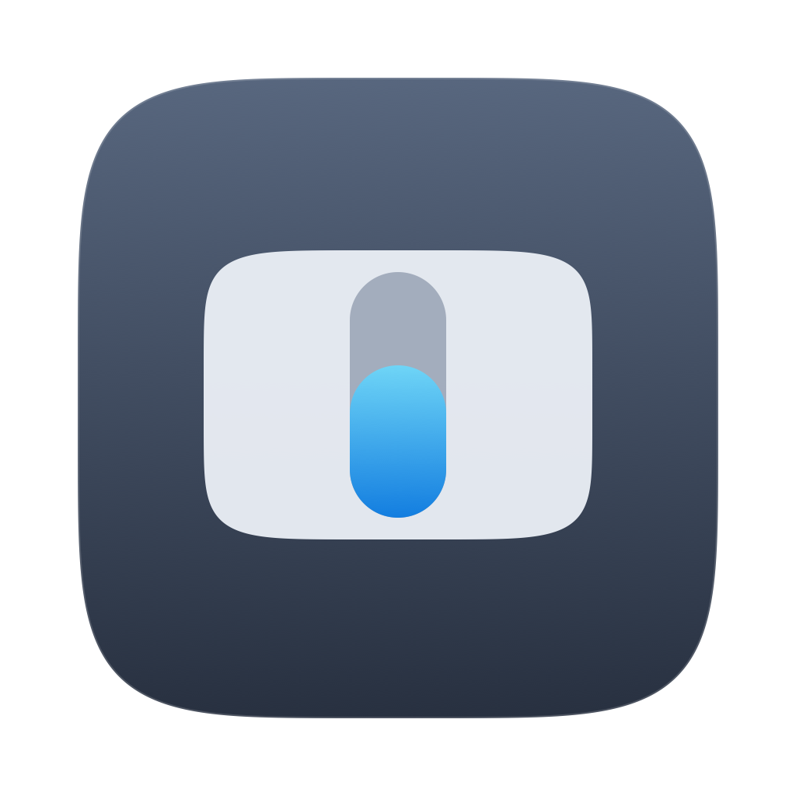
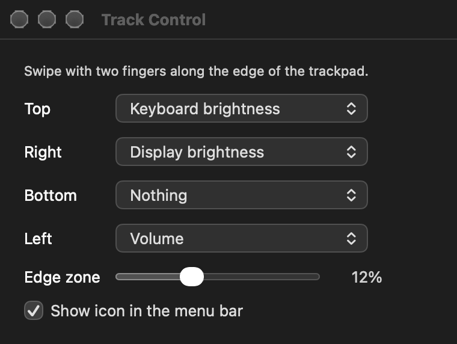

> **Branch `linux`** — Rust port for Linux: evdev MT-B contacts, sysfs brightness, PipeWire volume, StatusNotifierItem tray; scroll suppression on X11 only.

<p align="center">
  
</p>

<h1 align="center">Track Control</h1>

<p align="center">
  <a href="README.ru.md">Русская версия</a>
</p>

<p align="center">
  Volume, display brightness and keyboard backlight, from the four edges of your trackpad.
</p>

Two-finger swipes along the edges of the MacBook trackpad control system
settings — the open-source take on apps like Slidr. Each of the four edges
can be mapped to a different setting, and the mapping is configurable from the
app's settings window.

<p align="center">
  
</p>

Default mapping:

| Edge   | Setting             |
| ------ | ------------------- |
| Left   | Volume              |
| Right  | Display brightness  |
| Top    | Keyboard brightness |
| Bottom | Nothing             |

Swiping towards the "increase" end of the edge (upwards for the left and right
edges, rightwards for the top and bottom edges) raises the value, swiping back
lowers it. A swipe that covers a third of the edge changes the value by about a
third.

**Edge zone** in the settings window controls how close to an edge two fingers
have to start, as a share of the trackpad (2% to 30%, 12% by default). While a
swipe is running the app drops the scroll events that would otherwise scroll the
window underneath.

**Show icon in the menu bar** hides the status item. Opening the app again brings
up its settings window, which is where the checkbox lives.

## Build

Requires macOS 14 or newer and the Xcode Command Line Tools (`xcode-select
--install`); a full Xcode install is not needed. `scripts/build-app.sh` builds a
universal binary (arm64 + x86_64), so the same app runs on Intel Macs.

The SDK that ships with macOS 27 marks the x86_64 slice as deprecated, and its
Swift compatibility archive has no x86_64 slice, so linking for Intel prints one
`x86_64 architecture is deprecated` warning. It is expected: the app still links
and runs. Building against `MacOSX26.5.sdk` silences it.

```sh
./scripts/build-app.sh
open build/TrackControl.app

# to keep it as your everyday app:
ditto build/TrackControl.app /Applications/TrackControl.app
```

The script builds the package, assembles `build/TrackControl.app` and signs it
with the local signing identity, so the Accessibility grant survives rebuilds
and the app can be replaced or moved without granting it again.

For disk images to hand out:

```sh
./scripts/make-dmg.sh     # -> build/TrackControl-<version>-arm64.dmg
                          #    build/TrackControl-<version>-x86_64.dmg
```

One image per architecture, so the download matches the Mac. Each holds a
single-slice copy of the app, and the script refuses to finish if the bundle
inside the image has the wrong slice or a signature that does not verify.

The version comes from `CFBundleShortVersionString` in `Resources/Info.plist`.
The images contain ad-hoc signed copies of the app, because the local
development certificate is only trusted on the machine that made it. The
development build in `build/` is left alone.

## Permissions

Volume and display brightness work immediately. Two things need **Accessibility**
access:

- blocking the scroll that would otherwise reach the app you are working in;
- pressing the media keys, which is how volume and keyboard brightness move:
  without the permission the volume is written directly instead, so it still
  changes but the system HUD does not follow the swipe.

Nothing is asked for at launch. The system prompt appears only when you choose
Volume or Keyboard brightness for an edge — the two settings that press keys —
or when you click the button in the app's settings window, which opens the right
pane of System Settings. Display brightness and the gestures themselves need no
permission at all.

Without the permission the app still runs, the scroll simply goes through as
well and keyboard brightness does nothing. A grant made while the app is running
takes effect as soon as you come back to the app.

## How it works

- Trackpad contacts come from the private `MultitouchSupport.framework`, loaded
  at runtime (`MTDeviceCreateList` + `MTRegisterContactFrameCallbackWithRefcon`).
  Only the built-in trackpad is used, and only touching contacts.
- `EdgeSwipeRecognizer` is a pure state machine: two fingers that start inside
  the edge zone (12% of the trackpad by default, adjustable in settings, one of
  them within half of it) and travel along that edge produce swipe deltas.
  Drifting away from the edge cancels the gesture.
- `ActionRunner` applies the deltas: display brightness through `DisplayServices`,
  volume and keyboard backlight through the system's own media keys (the same
  keys the Fn row presses), which is what makes macOS draw its HUD while you
  swipe. Volume moves in the system's 16 steps, so the level appears gradually
  instead of jumping to the final value.
- While a swipe runs, an event tap drops scroll events so the window underneath
  stays put.

## Checks

```sh
swift run TrackControlSelfTest            # gesture recognizer, headless
swift run TrackControlSelfTest --system   # drives real volume/brightness changes
```

Set `TRACKCONTROL_DEBUG=1` in the environment to write frames and setting
changes to `~/Library/Logs/TrackControl.log`.
