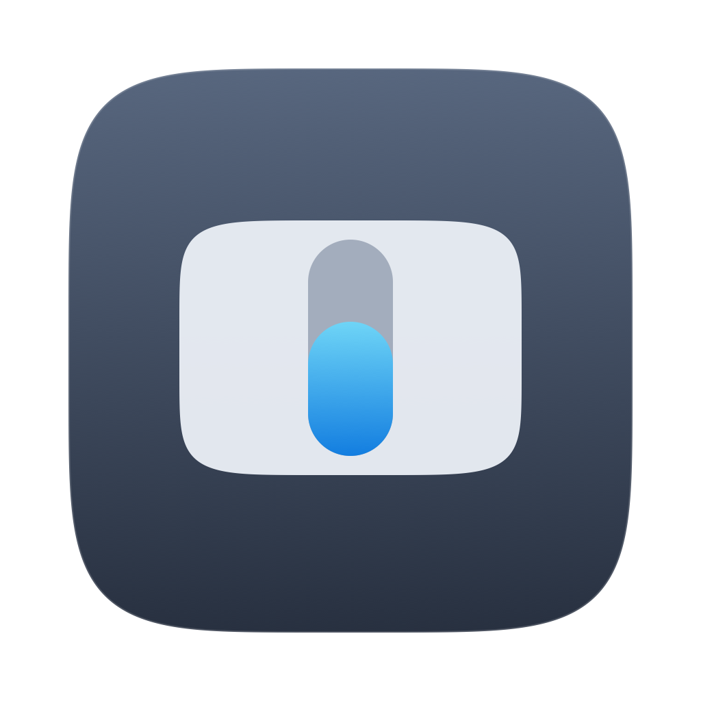
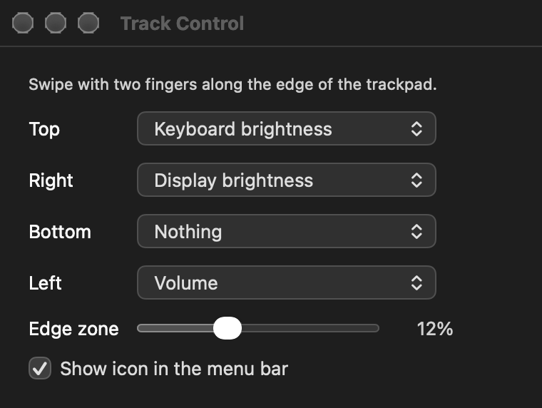

<p align="center">
  
</p>

<h1 align="center">Track Control</h1>

<p align="center">
  Громкость, яркость экрана и подсветка клавиатуры — с четырёх краёв трекпада.
</p>

Свайпы двумя пальцами по краям трекпада MacBook управляют системными
настройками — открытая альтернатива приложениям вроде Slidr. Каждый из четырёх
краёв можно назначить на отдельную настройку; соответствие настраивается в окне
настроек приложения.

<p align="center">
  
</p>

Сопоставление по умолчанию:

| Край     | Настройка            |
| -------- | -------------------- |
| Левый    | Громкость           |
| Правый   | Яркость экрана      |
| Верхний  | Подсветка клавиатуры |
| Нижний   | Ничего              |

Свайп в сторону «увеличения» (вверх для левого и правого краёв, вправо для
верхнего и нижнего) повышает значение, обратный свайп — понижает. Свайп на
треть длины края меняет значение примерно на треть.

**Edge zone** (зона края) в окне настроек задаёт, насколько близко к краю должны
начать движение два пальца, в долях трекпада (от 2 % до 30 %, по умолчанию
12 %). Пока идёт свайп, приложение отбрасывает события прокрутки, которые иначе
прокрутили бы окно под курсором.

**Show icon in the menu bar** скрывает значок в строке меню. Повторный запуск
приложения открывает окно настроек — там и находится этот флажок.

## Сборка

Нужны macOS 14 или новее и Xcode Command Line Tools (`xcode-select --install`);
полная установка Xcode не требуется. `scripts/build-app.sh` собирает
универсальный бинарник (arm64 + x86_64), поэтому то же приложение работает и на
Intel Mac.

SDK из состава macOS 27 помечает срез x86_64 как устаревший, а его архив
совместимости Swift не содержит среза x86_64, поэтому при линковке под Intel
выводится одно предупреждение `x86_64 architecture is deprecated`. Это
ожидаемо: приложение всё равно линкуется и работает. Сборка против
`MacOSX26.5.sdk` убирает предупреждение.

```sh
./scripts/build-app.sh
open build/TrackControl.app

# чтобы оставить приложение на каждый день:
ditto build/TrackControl.app /Applications/TrackControl.app
```

Скрипт собирает пакет, формирует `build/TrackControl.app` и подписывает его
локальным сертификатом, поэтому разрешение Accessibility (Универсальный доступ)
сохраняется между пересборками, а приложение можно заменять или переносить без
повторной выдачи разрешения.

Для образов дисков, которые раздают:

```sh
./scripts/make-dmg.sh     # -> build/TrackControl-<version>-arm64.dmg
                          #    build/TrackControl-<version>-x86_64.dmg
```

Один образ на архитектуру, чтобы загрузка соответствовала Mac. В каждом лежит
копия приложения только для одной архитектуры; скрипт не завершится, если внутри образа окажется
не тот срез или подпись не пройдёт проверку.

Версия берётся из `CFBundleShortVersionString` в `Resources/Info.plist`. В образах
лежат копии приложения с ad-hoc подписью, потому что локальный сертификат
разработки доверенный только на машине, где он создан. Сборка в `build/` при
этом не трогается.

## Разрешения

Громкость и яркость экрана работают сразу. Две вещи требуют доступа
**Accessibility** (Универсальный доступ):

- блокировка прокрутки, которая иначе дошла бы до приложения, в котором вы
  работаете;
- нажатие медиа-клавиш — так меняются громкость и подсветка клавиатуры: без
  разрешения громкость записывается напрямую, поэтому она всё равно меняется,
  но системный HUD не следует за свайпом.

При запуске ничего не запрашивается. Системное окно появляется только когда вы
назначаете на край Volume или Keyboard brightness — эти две настройки эмулируют
нажатия клавиш, — либо когда нажимаете кнопку в окне настроек, которая открывает нужный
раздел «Системных настроек». Яркости экрана и самим жестам разрешения не нужны.

Без разрешения приложение продолжает работать: прокрутка просто проходит как
обычно, а подсветка клавиатуры ничего не делает. Разрешение, выданное во время
работы приложения, применяется, как только вы возвращаетесь в приложение.

## Как это работает

- Контакты трекпада приходят из приватного `MultitouchSupport.framework`,
  который загружается в рантайме (`MTDeviceCreateList` +
  `MTRegisterContactFrameCallbackWithRefcon`). Используется только встроенный
  трекпад и только касающиеся контакты.
- `EdgeSwipeRecognizer` — чистый конечный автомат: два пальца, начавшие движение
  внутри зоны края (по умолчанию 12 % трекпада, значение настраивается, один
  из них — в пределах половины этой зоны) и движущиеся вдоль края, дают дельты
  свайпа. Уход от края отменяет жест.
- `ActionRunner` применяет дельты: яркость экрана через `DisplayServices`,
  громкость и подсветку клавиатуры — системными медиа-клавишами (теми же, что
  нажимает ряд Fn); именно поэтому macOS рисует свой HUD во время свайпа.
  Громкость меняется в системных 16 шагах, поэтому уровень растёт постепенно, а
  не прыгает к конечному значению.
- Пока идёт свайп, event tap отбрасывает события прокрутки, чтобы окно под ним
  оставалось на месте.

## Проверки

```sh
swift run TrackControlSelfTest            # распознаватель жестов, без интерфейса
swift run TrackControlSelfTest --system   # реально меняет громкость и яркость
```

Задайте `TRACKCONTROL_DEBUG=1` в окружении, чтобы писать кадры и изменения
настроек в `~/Library/Logs/TrackControl.log`.
